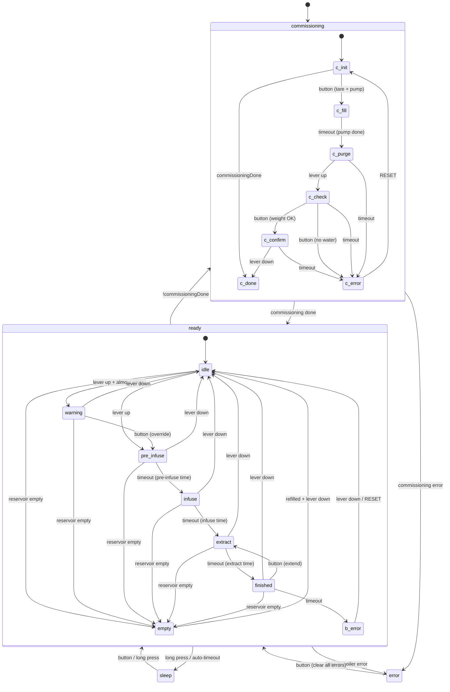
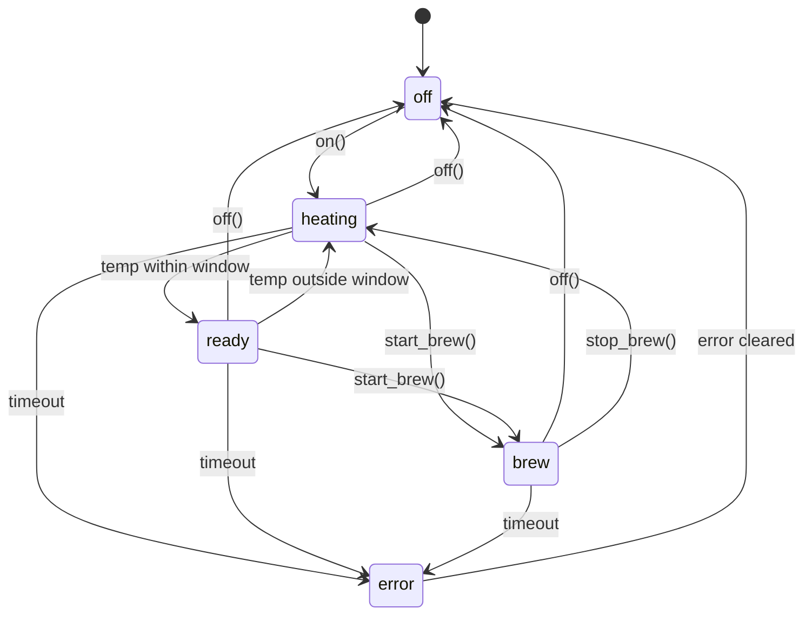
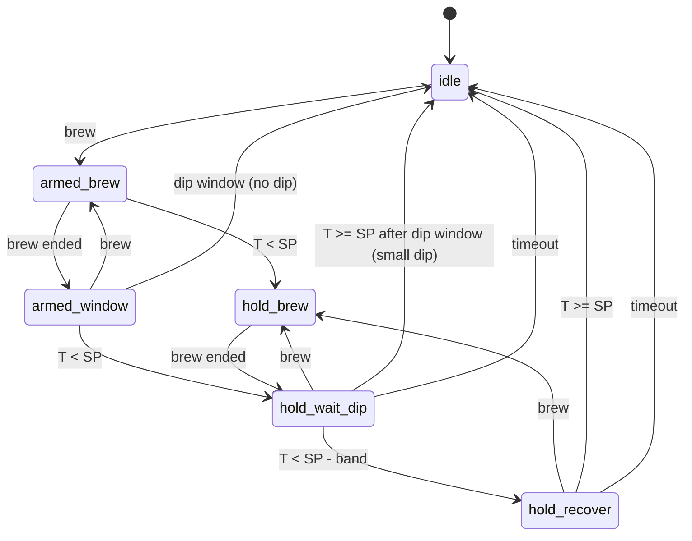

# diyPresso State Machines

## Machine Controller + Sub-FSMs

The MachineController is the top-level orchestrator. It dispatches to the CommissioningProcess
and BrewProcess sub-FSMs in the `commissioning` and `ready` states respectively.

## Boiler Controller

The BoilerStateMachine runs independently as a peer controller (PID + safety).

## Brew Integral Hold

The BrewIntegralHold FSM is owned by the BoilerStateMachine and runs every boiler cycle. It freezes the
boiler PID integral term during the post-brew temperature dip, so the integral does not build up and
cause overshoot. A brew only arms the hold; the hold activates at the dip (T < setpoint), so before the
dip the integral can still correct a pre-brew excess.

It is reset to `idle` on boiler off, error, setpoint change, or when `brewIntegralHold=0`.
"Timeout" is `brewHoldTimeoutSec` after the brew ended; "dip window" is `brewHoldDipWindowSec` after the
brew ended; "band" is `BREW_HOLD_DIP_BAND` (0.2 °C). The state is shown as `brewIHold` in the PID serial
output and as `brewIntegralHoldState` in `GET info`.

Integral hold is active in `hold_brew`, `hold_wait_dip` and `hold_recover`. The dip arrives at the
sensor 35–50 s after brew start, so in `hold_wait_dip` T ≥ SP only releases once the dip window has
passed since the brew ended.
